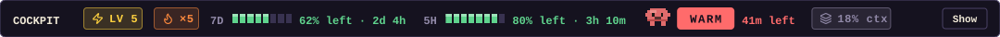
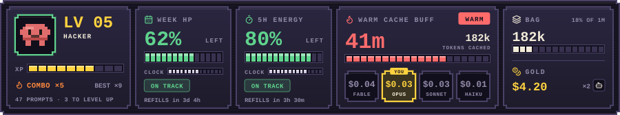
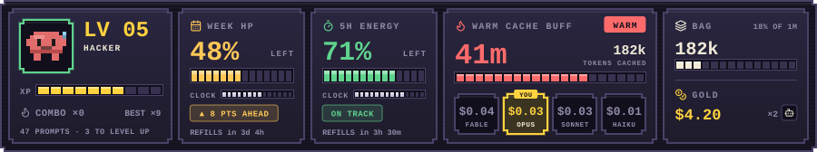
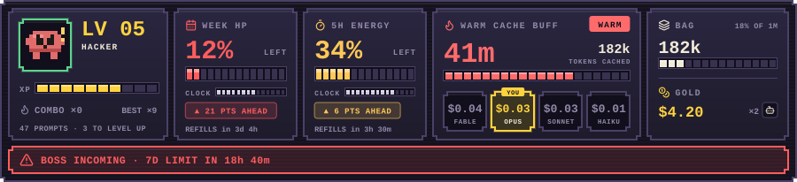
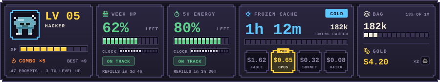
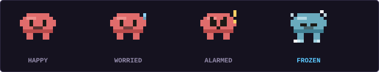
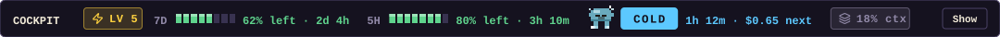
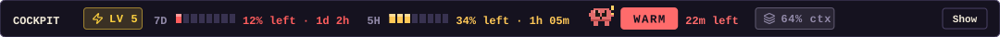

# 🎮 cockpit

**A game HUD for your Claude Code session.** One slim row above the prompt tells you how much usage you have left, whether your prompt cache is still warm, and how your session is going. Press **Show** for a full arcade-style card.



> The images in this README are drawn by the mod's own drawing code (`hooks/art.ts`) with sample numbers, by `scripts/render-docs.ts`. They are not captures of a live session, and the one-row band is laid out by hand in that script. Real screenshots are welcome in a pull request.

---

## 🕹️ Install

At the prompt of a terminal Claude Code session:

```
/plugin install cockpit --marketplace kmssiz/cockpit
```

Answer `y` to add the marketplace, then pick a scope. From a shell:

```
claude plugin install cockpit --marketplace kmssiz/cockpit
```

---

## 📟 The band (always visible)

Left to right:

| Piece | What it means |
| --- | --- |
| **LV 5** | Your level. One level per 10 prompts in this session. |
| **×5** | Combo: how many prompts in a row you stayed in the green. Shows from ×2. |
| **7D / 5H** bars | How much of your 7-day and 5-hour usage limits is **left**, and when each resets. |
| **Mascot + WARM / COLD** | The state of your prompt cache (below), with the time left or the idle time. |
| **18% ctx** | How full the context window is. |
| **Show / Hide** | Opens or closes the detail card. |

It opens the card for you when the cache goes cold or a warning appears.

## 🃏 The card



- **LV and XP**: your level, a title (Rookie, Apprentice, Coder, Hacker, Wizard, Archmage), XP towards the next level, your current combo and your best combo.
- **WEEK HP**: your 7-day limit as a health bar, with a clock bar for how much of the week has passed, and when it refills.
- **5H ENERGY**: the same for the 5-hour window.
- **Cache buff**: the cache timer, tokens cached, and what your next message would cost on each model (**YOU** marks yours).
- **Bag**: context size and how full the window is.
- **Gold**: estimated session cost, and the number of subagents.

---

## 🚦 What each state means

### Usage: green, yellow, red

Cockpit compares how much of a window you have **used** with how much of its **time** has passed. Spending at an even pace is fine; getting ahead of the clock is not.

| Color | Meaning | Badge on the card |
| --- | --- | --- |
| 🟢 **Green** | You are on or under pace. | `ON TRACK` |
| 🟡 **Yellow** | You are using it faster than the clock, by up to 15 points. | `▲ N PTS AHEAD` |
| 🔴 **Red** | You are more than 15 points ahead of the clock, or you have used 90% or more. | `▲ N PTS AHEAD` |

Below 15% left, a bar also shows **LOW**.



*Yellow: the week is a little ahead of the clock. Not urgent, but you are spending faster than time passes.*

### Boss incoming

At this week's pace, if the 7-day limit would run out before it refills, a red banner shows when: **BOSS INCOMING · 7D LIMIT IN 18h 40m**. The band shows the same warning as `7D out in …`. It needs about six hours of the week to have passed and 5% used before it will guess.



When there is no warning, the card says nothing, and the quest line is not drawn.

### Prompt cache: WARM or COLD

Claude keeps your conversation in a prompt cache for about an hour after your last message. Reading from it is much cheaper than rebuilding it.

| State | Meaning |
| --- | --- |
| 🔥 **WARM** `41m left` | The cache is alive. Your next message is cheap. The number is the time until it expires. |
| ❄️ **COLD** `1h 12m` | You were idle too long and it expired. The next message rebuilds the whole conversation at a higher price, shown next to it as `$0.65 next`. |



Tip: if you will be away for a while, a COLD cache is a good moment to start a fresh session or compact, instead of paying to rebuild a long one.

### The mascot

The little critter shows both the cache and your pace at a glance.



| Mood | Meaning |
| --- | --- |
| **Happy** | Cache warm, every window is green. |
| **Worried** | Cache warm, at least one window is yellow. A sweat drop shows. |
| **Alarmed** | Cache warm, at least one window is red. |
| **Frozen** (blue) | Cache is cold, whatever your pace. |

### The band in each state





### Context

The **Bag** is how full your context window is: normal under 60%, yellow from 60%, red from 80%, where the card adds "compact soon".

---

## ⭐ Level, XP and combo

- **XP and level**: every prompt you send in the session is worth one tenth of a level. Ten prompts, a new level.
- **Combo**: a prompt counts towards your combo when all your usage windows are green after it. A yellow or red window resets it to zero. **Best** remembers your longest run this session.
- These only count prompts in the current session; they are for fun, not a measure of anything else.

---

## ⚠️ Honest notes

- Costs are list-price **estimates**, from the model table in `hooks/register.tsx`. Check them against current prices; your real bill may differ.
- It makes **no model calls**. It only reads figures the engine already has and draws them.
- The terminal surface gets a plain-text fallback of the band.
- The card is drawn as SVG, so it renders only on the desktop app, VS Code and mobile surfaces.

## 🛠️ Develop

```
claude --plugin-dir <path-to-your-clone>
```

To redraw the README images after changing the art (needs Node 24 or newer):

```
node scripts/render-docs.ts
```

## 📜 License and credits

MIT, see [LICENSE](LICENSE). cockpit is an independent implementation inspired by [Ribbon](https://github.com/robonuggets/ribbon) and [claude-mods](https://github.com/augiefra/claude-mods); icons are from [Lucide](https://lucide.dev). Details in [NOTICE.md](NOTICE.md).
